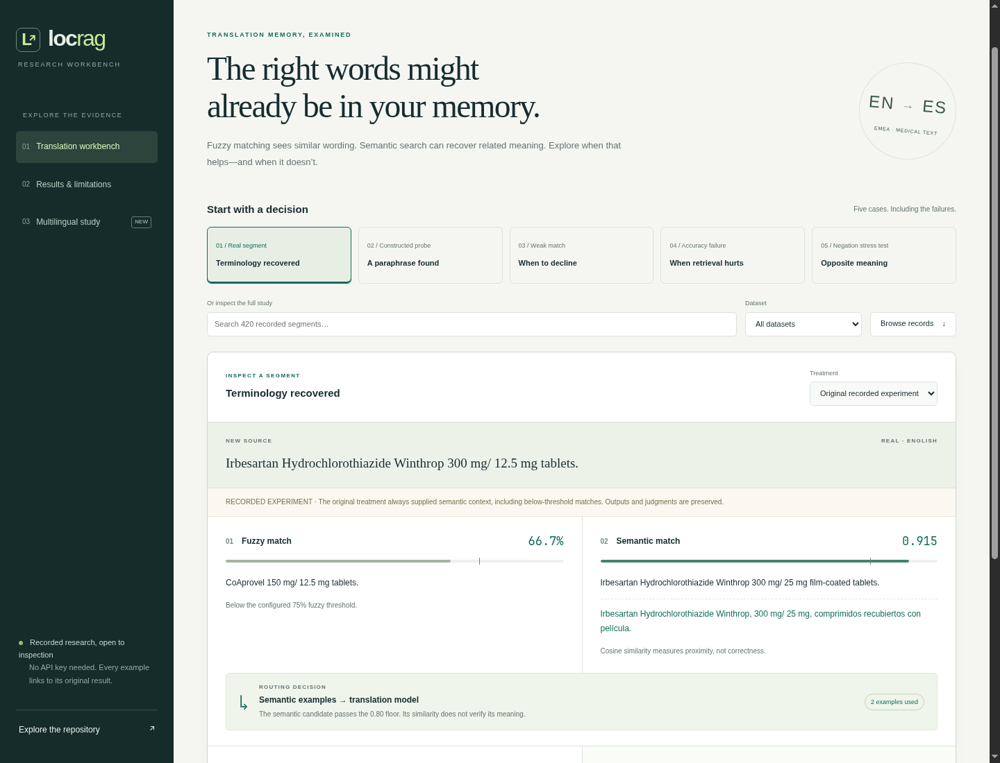
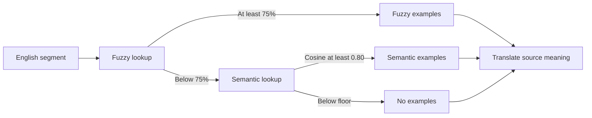

# LocRAG

**When should a translator reuse a translation memory—and when should the system decline?**

LocRAG compares fuzzy matching, semantic retrieval, and selective routing for translation-memory-assisted machine translation. It includes a no-key evidence workbench, auditable experiment outputs, and a matched Spanish / German / Simplified Chinese evaluation protocol.



**[Audited findings](results/audit/report.md)** · **[Architecture](docs/architecture.md)** · **[Reproduction](docs/reproduction.md)** · **[Multilingual protocol](docs/multilingual.md)**

## Latest completed evaluation

**[Plain-language results and full evidence](results/runs/2026-11-16/README.md)** — all three language runs and the original Spanish experiments completed.

Adding semantic fallback to ordinary fuzzy matching, on 300 software-localization sentences per target language:

| Target | Better | Worse | Tie |
|---|---:|---:|---:|
| Spanish | 14 | 8 | 278 |
| German | 20 | 3 | 277 |
| Simplified Chinese | 8 | 6 | 286 |

German shows the clearest benefit in this sample; Spanish and Chinese are mixed. The new search was used on 43/300 inputs, so most cases were unchanged. Meaning errors were both introduced and fixed; general accuracy improvement is unproven. These are automated judgments, not human review. The corrected medical-text router received 50 wins, 9 losses and 241 ties on 300 cases.

The demo below presents the original archived study; the linked report contains the completed new evaluation.

Owner-only [hosted preview](https://locrag-translation-workbench.warm-pika-3490.chatgpt.site). Public portfolio sharing is not enabled; anyone cloning the repo can use the local no-key demo below.

## Try the workbench

```bash
uv sync --locked
uv run python -m locrag.demo
python -m http.server 8000 --bind 127.0.0.1 --directory demo/dist
```

Open **http://127.0.0.1:8000**. No API key, embedding model, or corpus download is needed. Inspect 420 recorded examples, output differences, judge notes, and failure cases. Selective replay is explicitly labeled; it reuses saved outputs and performs no fresh inference.

## What the evidence supports

The original study uses a 20,000-entry English→Spanish EMEA memory. The fuzzy matcher is a word-level Levenshtein approximation with a configured 75% threshold, not a reproduction of a particular commercial CAT tool.

| Question | Observed result | Interpretation |
|---|---|---|
| Can semantic search find reworded entries? | BGE-M3 ranked the original or an accepted near-duplicate first on 39/40 paraphrases and 40/40 restructures. | Strong retrieval on a small, hand-written probe set. |
| How many below-threshold segments have useful candidates? | 85/300 passed the semantic floor; 65 of those were judged reusable. | 28% coverage; about 22% of all segments had a passing candidate judged useful. |
| Does context improve terminology/phrasing consistency? | Localization rubric: 50 wins / 22 ties / 13 losses among the 85 passing segments. | A workflow-specific benefit in a selected subset. |
| Is translation accuracy improved or equivalent? | Rated accurate: 84/85 zero-shot versus 82/85 with retrieval. | Neither improvement nor equivalence is established. |
| Does it generalize to German and Chinese? | The new matched KDE4 evaluation is complete; see the table above. | German shows clearer added benefit; Chinese is mixed. |

**Evaluation correction:** the original 300-segment experiment supplied a semantic example even when its route label was `none`. Its full-set results describe that exploratory treatment, not the selective router. Original raw outputs remain unchanged. New evaluations use `TMRouter.route()` directly and no-route decisions supply no examples. See the [generated audit](results/audit/report.md).

The generic and localization rubrics used the same judge model. They are not independent human judgments. No human-reviewed polarity benchmark supports a general safety claim.

## How it works



Thresholds are configurable and exploratory. Similarity is not a correctness probability. The router explains each decision, handles small and empty memories, and loads embeddings only when needed.

## Check the evidence

```bash
uv run pytest -q
uv run python -m locrag.evidence
```

These commands run offline after dependency installation. Reports are rebuilt from committed outputs with source SHA-256 hashes, metric signatures, and explicitly labeled uncertainty. CI also builds the static workbench.

## Spanish, German, and Simplified Chinese

The next study uses **the same English source segments** from OPUS KDE4 software localization for all three targets: 42,461 shared eligible sources; 5,000 memory entries, 150 development segments, and 300 test segments per language. Normalized-source groups keep numeric/placeholder variants in one split.

```bash
bash scripts/download_kde4.sh
uv run python -m locrag.multilingual prepare
uv run python -m locrag.multilingual plan
```

Four conditions compare zero-shot, thresholded fuzzy, always-semantic, and selective routing. Character-only chrF is the primary multilingual metric; meaning errors and terminology judgments remain separate. The [data audit](results/multilingual/data_audit.json) records hashes, counts, fuzzy bands and measured prefilter behavior. The completed [raw outputs and metrics](results/multilingual/validation-v1/) are available. Read the [protocol](docs/multilingual.md) before repeating inference.

## Translate a new segment

Configure a provider in `.env` using `.env.example`, then supply a JSONL memory with `src` and `tgt` fields:

```bash
uv run python -m locrag.pipeline "Open the settings window." \
  --tm data/multilingual/de/tm.jsonl --target de \
  --domain "software interface localization" --json
```

Targets: `es`, `de`, `zh_CN`. JSON responses include route, examples, reason, translation and durations. Credentials stay on the machine running the CLI. For local embeddings install `uv sync --extra local`; weights download separately on first use. The static demo never calls a provider.

## Repository map

| Path | Purpose |
|---|---|
| `locrag/pipeline.py`, `retrievers.py` | Shared routing, translation, retrieval |
| `locrag/evidence.py` | Offline evidence reconstruction |
| `locrag/multilingual.py` | Matched splits, fuzzy audit, explicit model runs |
| `experiments/multilingual.json` | Frozen study configuration |
| `demo/src/`, `locrag/demo.py` | Browser workbench and artifact builder |
| `tests/`, `.github/workflows/` | Regression checks and CI |
| `results/benchmarks/`, `results/router/` | Original exploratory results |
| `results/audit/`, `results/multilingual/` | Corrected summaries and new data audit |

## Data and license

Code: MIT. Data: [OPUS EMEA](https://opus.nlpl.eu/legacy/EMEA.php) and [OPUS KDE4](https://opus.nlpl.eu/legacy/KDE4.php), credited to their contributors. Corpora are not covered by the code license. Downloads/prepared splits are ignored; results and the demo contain excerpts for analysis. Citation: Jörg Tiedemann, *Parallel Data, Tools and Interfaces in OPUS*, LREC 2012.
