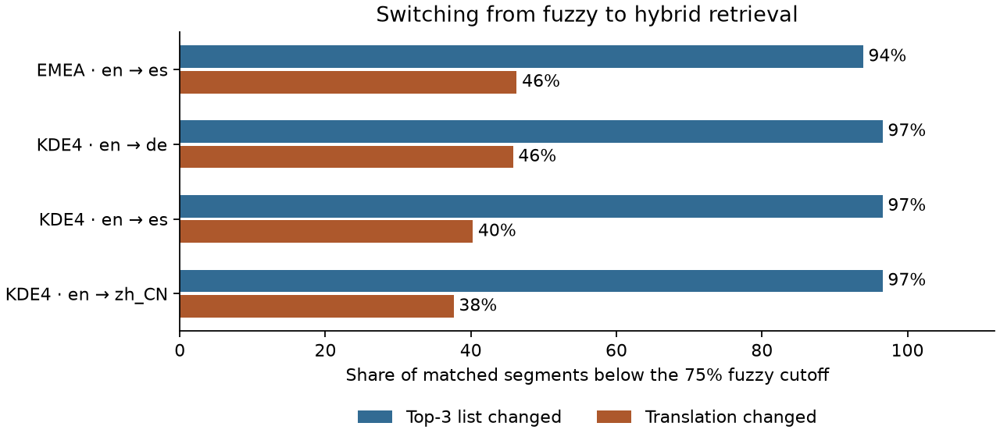

# LocRAG · What can a translation memory recover below the fuzzy-match cutoff?

A localization tool configured with a 75% fuzzy-match cutoff can return an empty result even when the translation memory (TM) contains exactly the phrase a translator needs. LocRAG tests what happens on those rejected segments. The baseline translates the new source with no memory examples. The alternatives retrieve older bilingual examples and let the translator reuse the parts that still apply.

## Does the memory make wording more consistent?

For the English term **“Starter pack,”** the best fuzzy match scored **41.67%**. The three closest lexical matches contained lists of tablet counts. Gemma translated the term as *Pack de inicio* both with those matches and without memory. Semantic retrieval found a historical starter-pack description, and Gemma used *Envase de iniciación*. Two separate TM entries documented that wording. A source-only accuracy judge accepted all three translations.

How often did that happen? We froze one independently evidenced convention per eligible source and scored **consistency and accuracy separately** on blinded outputs. The main panel covered 480 English→Spanish medical and software segments in six fuzzy bands, with a below-cutoff replication on 100 Astra segments.

| Below 75% fuzzy · Gemma | No memory | Top-3 fuzzy | Top-3 semantic |
|---|---:|---:|---:|
| Followed the established convention | 109/152 (71.7%) | 119/152 (78.3%) | 120/152 (78.9%) |
| Passed the separate meaning check | 155/160 (96.9%) | 152/160 (95.0%) | 150/160 (93.8%) |

Most of the consistency gain below the cutoff came from supplying TM examples by either method. The semantic-over-fuzzy consistency advantage was **+0.7 percentage points below 75** and **+2.0 points at 95–100**. The difference between those advantages was **−1.4 points [95% interval −7.4, +4.6]**. The predicted increase at low fuzzy scores did not appear. On the 100-source Astra replication both retrieval methods followed the convention on 78 of 94 eligible sources, compared with 74 without memory. All ratings are automated. [Consistency and accuracy report, including all six bands, QE and failure cases](docs/consistency-results.md)

## How often was there something to reuse?

The earlier multilingual study sampled medical text (EMEA) and software strings (KDE4). On below-cutoff segments, an automated auditor identified full or partial reuse and supplied a span that could be checked verbatim against the historical translation. After weighting the two fuzzy-score bands to their observed corpus frequencies, the estimated shares with substantive reusable material were **95.7% for EMEA** and **79.6% for KDE4**. Even when allowed to return its three best matches regardless of score, fuzzy search missed substantive material that semantic search found on **25 of 200 audited medical segments** and **8 of 121 software segments**. The audit measures availability. Whether a translator uses a span correctly is a separate outcome. [Reuse labels, sampling and limitations](docs/v2-results.md)

## What changed when the translator received the examples?

Every row in this comparison had a best fuzzy score below 75%. Each difference compares the same translator on the same source with and without TM examples. chrF measures agreement with the corpus reference.

| Examples supplied below the cutoff | Gemma · 2,140 multilingual segment–language pairs · ΔchrF [95% CI] | Astra · 100 English→Spanish segments · ΔchrF [95% CI] |
|---|---:|---:|
| Three random examples from the same domain | — | +0.05 [−1.12, +1.14] |
| Top three fuzzy matches with the cutoff lifted | +5.0 [+4.3, +5.7] | +0.68 [−0.78, +2.17] |
| Top three semantic matches | +4.9 [+4.2, +5.7] | +2.23 [+0.17, +4.49] |
| Top three from the combined rankings | +5.0 [+4.3, +5.8] | +2.10 [+0.40, +3.79] |

The larger Gemma run showed a gain in reference agreement even with simple fuzzy retrieval below threshold. Its preregistered reference-free quality metric moved in the other direction (semantic context **−0.47 CometKiwi points** on a 100-point scale). In the smaller Astra panel, the semantic-context reference gain was concentrated in software strings. Its TM-versus-no-TM intervals are retrospective, pointwise comparisons. Neither study measured time saved in human post-editing. [Gemma results](docs/v2-results.md) · [Astra protocol and results](docs/frontier.md) · [Numerical summary](results/frontier/summary.json)

### Does the choice of retriever matter?

This was the frontier run’s original primary comparison. Both candidates received memory. A blinded judge comparing hybrid against fuzzy context on meaning preferred hybrid on 3 segments and fuzzy on 4, with 87 ties and 6 order-dependent verdicts. The subsequent consistency study grades both fuzzy and semantic translations alongside zero-shot for accuracy and adherence to established wording. The figure below shows how often changing the retrieval method changed the examples and the final translation in the larger Gemma run.



Rebuild the Gemma comparison with `uv run python -m locrag.study.retriever_comparison` and the Astra results with `uv run python -m locrag.study.frontier summarize`. Both use saved outputs. [Retriever comparison](results/retriever-comparison/summary.json) · [Original exploratory study](results/runs/2026-11-16/README.md)

## What's implemented

The v2 study lives in `locrag/study/` and runs as `python -m locrag.study`. It covers exact word-level fuzzy matching, band-stratified held-out sampling with leakage checks, a resumable cached OpenRouter client with provider and cost logging, a DeepL control, a blinded QE scorer in its own environment (`qe/`), the Sonnet reuse and extractor auditor with a credit guard, and paired bootstrap, crossover and failure analyses. See the [v2 reproduction guide](docs/v2-reproduction.md).

The Python pipeline combines fuzzy matching, semantic retrieval, and translation. It supports Spanish, German, and Simplified Chinese, and reports which route it used and which examples it supplied. Empty memories and rejected matches fall back to translation without examples.

The v1 evaluation code prepares matched language splits, runs the four approaches, and saves translations and judgments for inspection. The multilingual runs used GPT-5.4-mini for translation, Claude Sonnet 5.5 for judging, and BGE-M3 for embeddings. A/B presentation order was randomized. Tests cover routing and evidence reconstruction; GitHub Actions runs the offline checks.

An earlier experiment supplied semantic context even when its route label said `none`. That is fixed in the current pipeline and completed reruns. The [audit](results/audit/report.md) documents the issue, and the original outputs remain available so the correction can be traced.

## Run it

Requires Python 3.12 or newer and [uv](https://docs.astral.sh/uv/).

```bash
uv sync --locked
cp .env.example .env
```

Add your provider credentials to `.env`. Supply a translation memory as JSONL, with `src` and `tgt` fields on each line:

```json
{"src": "Open the file.", "tgt": "Öffnen Sie die Datei."}
```

Then translate a segment:

```bash
uv run python -m locrag.pipeline "Open the settings window." \
  --tm path/to/memory.jsonl --target de \
  --domain "software interface localization" --json
```

Supported targets are `es`, `de`, and `zh_CN`. For local embeddings, install the optional dependencies with `uv sync --extra local`.

To run the tests and rebuild the saved results summary without making model calls:

```bash
uv run pytest -q
uv run python scripts/summarize_run.py
```

The [reproduction guide](docs/reproduction.md) covers the original experiments, and the [multilingual protocol](docs/multilingual.md) covers data preparation and the three-language evaluation. The [architecture notes](docs/architecture.md) explain the code structure.

To browse saved examples from the original archived Spanish study, an optional local demo needs no API key:

```bash
uv run python -m locrag.demo
python -m http.server 8000 --bind 127.0.0.1 --directory demo/dist
```

Open http://127.0.0.1:8000. The completed results linked above cover the newer runs.

## Data and license

Code is licensed under MIT. Translation data comes from [OPUS EMEA](https://opus.nlpl.eu/legacy/EMEA.php) and [OPUS KDE4](https://opus.nlpl.eu/legacy/KDE4.php), credited to their contributors. The code license does not cover the corpora. Downloaded datasets are excluded from the repository; saved results contain excerpts used in the evaluation.

OPUS citation: Jörg Tiedemann, *Parallel Data, Tools and Interfaces in OPUS*, LREC 2012.
