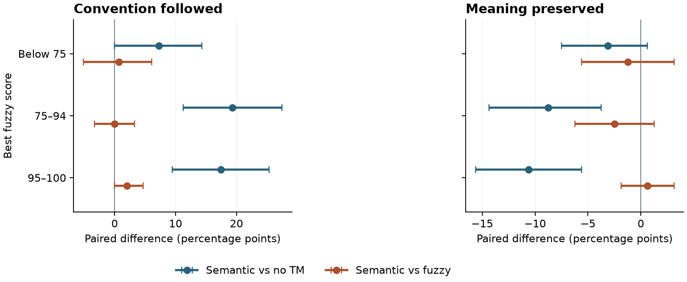

# Does translation memory improve consistency while preserving accuracy?

On Spanish medical and software text below a 75% fuzzy cutoff, both retrieval methods produced more translations that followed established TM wording than translating without memory. Semantic retrieval recovered individual terms missed by fuzzy retrieval. Its **net advantage over unthresholded fuzzy retrieval was one segment out of 152** on the main below-cutoff sample. The predicted increase in semantic advantage at low fuzzy scores did not appear.

## What was measured

We sampled 480 existing Gemma translations of distinct English sources, 40 from each combination of two domains and six fuzzy bands. For each source we compared Gemma without memory, with the top three lexical matches regardless of cutoff, and with the top three semantic matches. An additional 100 below-cutoff Astra sources tested whether the pattern recurred with a second translator. Eighteen sources occurred in both panels. We report the panels separately.

Before grading, GPT-6.2 Astra received the source and a separate concordance from the same domain TM. The concordance excluded the entries supplied by both retrievers and exact normalized source matches. The model could identify one applicable convention or abstain. On 527 of 562 unique sources it supplied a convention with literal Spanish evidence from two distinct historical entries. Corpus conventions stand in for client preferences.

GPT-6.2 Sol then graded each distinct anonymous translation twice under separate instructions. For consistency it saw the convention and checked the rendering in context. For accuracy it saw the source, domain and candidate translations only. Each output received a pass or fail on each applicable dimension. All sources count toward accuracy. Only sources with a documented convention count toward consistency. The protocol was frozen before collecting these annotations, after the underlying translations and earlier quality metrics existed. [Protocol and reproduction](../experiments/consistency/protocol.md) · [Recorded numerical results](../results/consistency/summary.json)

## Below the cutoff

| Translator and outcome | No memory | Top-3 fuzzy | Top-3 semantic |
|---|---:|---:|---:|
| Gemma · followed convention | 109/152 (71.7%) | 119/152 (78.3%) | 120/152 (78.9%) |
| Gemma · preserved meaning | 155/160 (96.9%) | 152/160 (95.0%) | 150/160 (93.8%) |
| Astra · followed convention | 74/94 (78.7%) | 78/94 (83.0%) | 78/94 (83.0%) |
| Astra · preserved meaning | 100/100 | 96/100 | 95/100 |

**Gemma.** Compared with no memory, semantic context gained **7.2 percentage points** in consistency (paired 95% interval **0.0 to +14.3**) and changed judged accuracy by **−3.1 points** (**−7.5 to +0.6**). Of the 152 eligible segments, it fixed 22 inconsistencies and introduced 11. In 21 of those fixes and nine of those losses, both outputs passed accuracy. Across all 160 segments it introduced eight judged meaning errors and fixed three. Switching from fuzzy to semantic context fixed ten inconsistencies and introduced nine. These paired counts explain how a small average can coexist with useful individual retrievals.

**Astra.** Semantic and fuzzy each matched the convention four more times than no memory. Semantic versus fuzzy was **0.0 points [−5.5, +5.6]**. Semantic versus no memory was **+4.3 points [0.0, +9.6]** for consistency and **−5.0 points [−10.0, −1.0]** for judged accuracy. A zero error count in one arm on 100 sources warrants caution, especially given the UI example below.

## Does semantic search pull ahead as fuzzy scores fall?

| Gemma best fuzzy score | Eligible / sampled | Consistent without TM | Consistent with fuzzy | Consistent with semantic | Semantic minus fuzzy, points [95% interval] |
|---|---:|---:|---:|---:|---:|
| <50 | 77/80 | 61 | 61 | 61 | 0.0 [−9.3, +9.2] |
| 50–74 | 75/80 | 48 | 58 | 59 | +1.3 [−4.1, +7.0] |
| 75–84 | 76/80 | 45 | 66 | 67 | +1.3 [−4.1, +6.9] |
| 85–94 | 74/80 | 52 | 60 | 59 | −1.4 [−4.2, 0.0] |
| 95–99 | 79/80 | 55 | 66 | 69 | +3.8 [0.0, +8.8] |
| 100 | 70/80 | 47 | 59 | 59 | 0.0 [0.0, 0.0] |

The primary test compares the **semantic-minus-fuzzy consistency difference** below 75 (**+0.7 points**) with the difference at 95–100 (**+2.0 points**). The low-minus-high difference was **−1.4 points [−7.4, +4.6]**. The prediction was a positive difference. The data allow some advantage in either direction. Equal totals in the <50 band also conceal offsetting changes. Intervals use 10,000 paired bootstrap resamples within domain and original band, with independent draws for low versus high. A degenerate interval at exact match describes the observed paired outcomes in that sample.

## What QE missed

In an exploratory check, we took the **21** below-cutoff Gemma cases where semantic context fixed an inconsistency relative to no memory and both translations passed accuracy. Only **two** had a CometKiwi increase reaching the earlier study’s regeneration-noise threshold (0.02157 on its native scale). **Fourteen** stayed within that threshold and **five** scored lower by at least that amount. This describes the selected fixes. It does not calibrate QE against all human judgments. [QE and paired counts](../results/consistency/summary.json)

## Three sources worth inspecting

- **A terminology win, E454684e46b6e:es (41.67% fuzzy).** For “Starter pack,” two independent TM entries used *Envase de iniciación*. Fuzzy retrieval returned lists of tablet counts. Gemma used *Pack de inicio* with those examples and with no memory. Semantic retrieval surfaced historical starter-pack wording and Gemma used *Envase de iniciación*. The accuracy judge accepted all three.
- **An accuracy loss, E53801654f6e2:es (57.89%).** The source specified “skin testing.” No-memory and fuzzy outputs used *pruebas cutáneas*. The semantic output used the broader *pruebas de sensibilidad*. The accuracy judge flagged the lost detail. A term can sound plausible in a domain while losing a source constraint.
- **A questionable automated grade, K934a8ff8a553:es (40%).** In “Refresh Project & Tree,” the convention assessor interpreted the ampersand as a UI mnemonic and found two independent examples of *árbol del proyecto*. The source-only accuracy judge interpreted it as connecting two objects and penalized Astra’s semantic output. The reference uses the project-tree reading. The recorded grade is retained. This case illustrates the effect of missing UI context and why human review is important for the accuracy percentages.

The sample uses two OPUS corpora, a sentence-level split, one term per eligible source and an English lexical concordance. Conventions with little lexical overlap may be harder to document this way. Blinded automated grading cannot establish client approval, editing time, or human accuracy. On the order-reversal subset, **83/84** accuracy grades and **78/79** consistency grades agreed across candidate orders. That measures repeatability within the same evaluator. Logged API usage for this study was approximately **$9.68** at uncached rates. No new translations were generated. [Source concordances](../experiments/consistency/sources.jsonl) · [Candidate translations](../experiments/consistency/translations.jsonl) · [Grades and explanations](../results/consistency/grades.jsonl)
